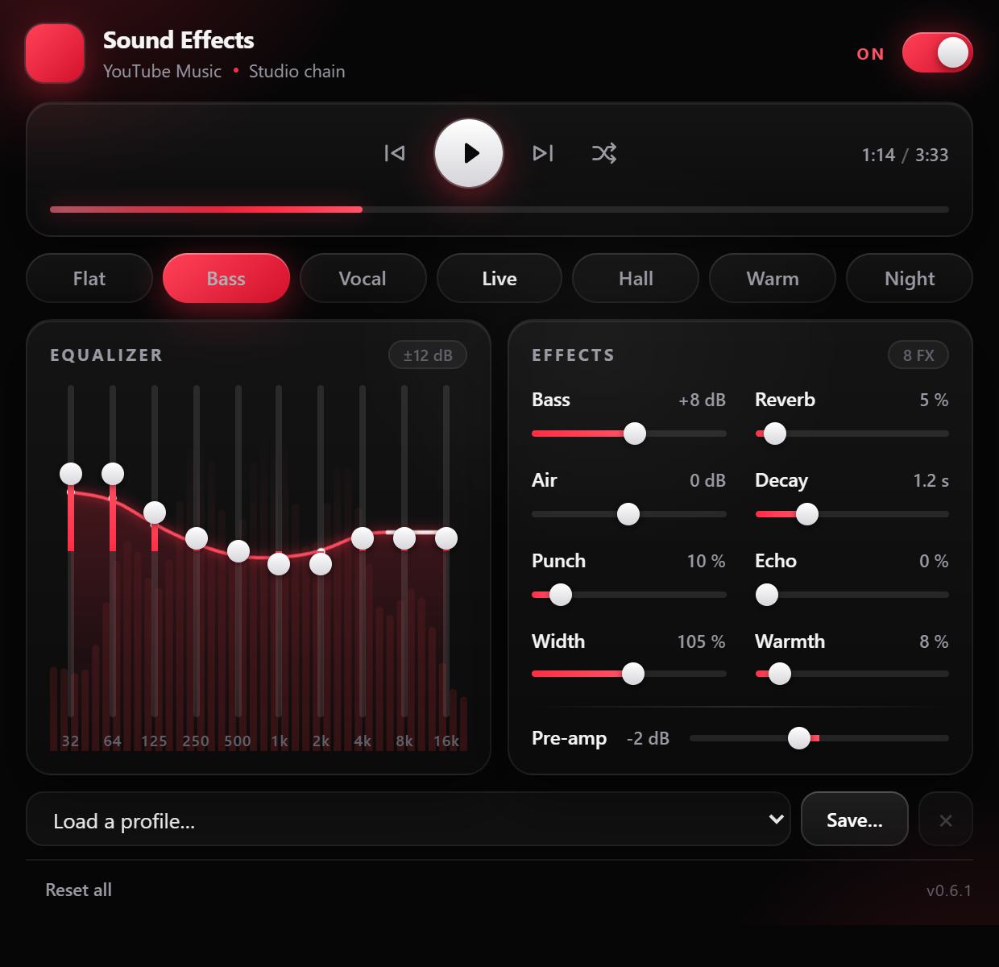
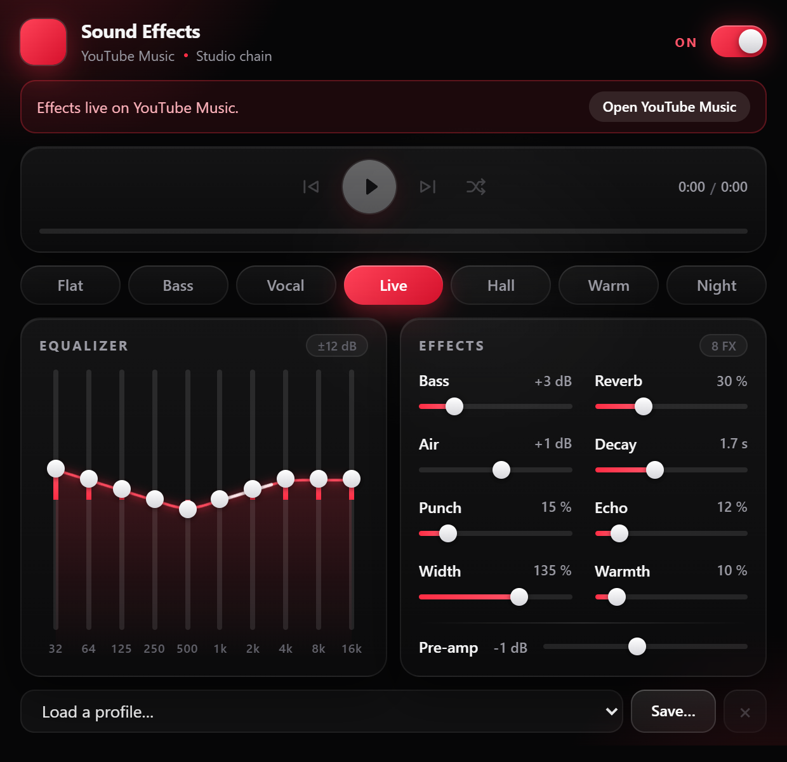

# YTM Sound Effects

[](manifest.json)
[](https://brave.com)
[](LICENSE)

**A real-time studio chain for YouTube Music.** A Manifest V3 extension for
Brave (and other Chromium browsers) that puts a 10-band equalizer, bass and air
shelves, punch compression, warmth saturation, stereo width, reverb and echo on
top of the track — live while it plays. It also adds saved profiles, remembered
shuffle, playback controls with click/drag seeking, a spectrum and response
curve inside the EQ card, and ad silencing.

## Screenshots

| Main popup | Bass preset | No YouTube Music tab |
| :---: | :---: | :---: |
|  |  |  |

## Features

| | |
|---|---|
| **10-band EQ** | 32 Hz → 16 kHz, ±12 dB per band, with a live gain readout and a centre-zero meter |
| **Bass boost** | Low-shelf at 100 Hz, 0 → +15 dB |
| **Air** | High-shelf at 4.2 kHz, −12 → +12 dB, for an open or darker top end |
| **Punch** | Bus compressor with automatic makeup; adds density without raising the fader |
| **Warmth** | Parallel tanh saturation for harmonic weight and a thicker midrange |
| **Width** | Mid/side stereo width, 0 % (mono) → 200 %; 100 % is exactly neutral |
| **Reverb** | Convolver with an impulse response generated in code (no audio files), adjustable wet/dry mix and 0.3–4 s decay |
| **Echo** | Warm 280 ms delay tap with a short feedback tail and a low-passed repeat |
| **Pre-amp** | −12 → +12 dB before the filters, so a boosted EQ does not clip |
| **Presets** | Flat, Bass, Vocal, Live, Hall, Warm, Night — one click, and the chip stays highlighted only while the settings match |
| **On/off switch** | Silences the effects instantly and restores them with one click; the chain stays connected, so audio never drops out |
| **Live visuals** | A spectrum graph behind the EQ faders only — never behind the rest of the popup (frozen when reduced motion is requested) |
| **Profiles** | Save the current settings under a name, switch between them instantly, delete with a two-click confirmation |
| **Transport** | Previous, play/pause, next and shuffle, driving YouTube Music's own player-bar buttons so the queue and history stay in sync |
| **Progress** | A glowing progress bar with a soft shimmer, interpolated every screen frame so it glides between telemetry frames, with elapsed and total time. Click or drag anywhere on it to seek; arrow keys move 5 s (Shift: 30 s), Home/End jump to the start/end |
| **Shuffle memory** | YouTube Music forgets shuffle on reload; the extension restores your last explicit choice on every new page |
| **Ad silence** | Ads are detected in the player and muted through the chain, then unmuted when the music returns. The site's own volume is never touched |
| **Persistence** | Settings, profiles and the shuffle preference live in `chrome.storage.local` and apply to every open tab immediately |

## How it works

The extension taps the page's `<video>` element and routes its audio through a
Web Audio graph:

```
<video> ─► source ─► pre-amp ─► EQ ×10 ─► bass ─► air ─► width ─► warmth
        ─► punch ─┬─► dry ───────────────────────────┐
                  ├─► convolver ─► reverb wet ───────┤
                  └─► delay ─► echo wet ─────────────┤
                                                     └─► limiter ─► master ─► analyser ─► destination
```

A few details that matter:

* **One media source per element, forever.** `createMediaElementSource()` can be
  called only once per element; the node is cached so rebuilds reuse it instead
  of throwing `InvalidStateError`.
* **Bypass is acoustic, not structural.** When the switch is off, every gain is
  set to neutral. Disconnecting the graph would silence the tab.
* **The master gain silences ads, not the site.** An ad is recognised from the
  player's `ad-showing`/`ad-interrupting` classes, the visible `.ytp-ad-*`
  overlay and badge, or the `Sponsored` line in the player bar. Any of those
  ramps the master gain to zero before the analyser, so no ad audio reaches the
  output and no ad bars reach the visuals. A `MutationObserver` on the player's
  class reacts within a frame; a 12 s evidence timeout only releases a stale
  `ad-showing` class. It never touches the page's volume or mute state. A
  visible *Skip* button is clicked when one exists. Ads cannot be blocked at the
  network level from a content script — they are muted and skipped.
* **YouTube Music is a SPA.** A poll plus a `MutationObserver` watch for the
  player element being replaced on navigation and rebuild the chain when it is.
* **Reverb without assets.** The impulse response is stereo decorrelated noise
  with an exponential decay envelope, rebuilt only when the decay length
  changes.
* **Width is a mid/side matrix.** At 100 % the two halves reconstruct the left
  and right channels exactly; 0 % folds to mono and 200 % stretches the sides.
* **Warmth is parallel, not destructive.** A normalised tanh curve runs beside
  the clean signal, so the dry path never loses detail and 0 % is neutral.
* **Punch is a bus compressor** with automatic makeup gain. At 0 % the ratio is
  1 and the stage is transparent; the safety limiter still follows it.
* **Echo is a short, warm tap** (280 ms, low-passed feedback) rather than a
  second reverb, so it adds depth without smearing the whole mix.
* **A limiter always sits at the end** (threshold −1 dB, ratio 20) so aggressive
  EQ settings cannot clip.
* **The analyser feeds the visuals**, and doubles as a health check: the popup
  polls one frame roughly eighteen times a second to draw the spectrum behind
  the faders, and the debug hook uses the same frame to prove audio is flowing.
* **The popup drives the page, not a second player.** Play/pause, next, previous
  and shuffle click YouTube Music's own player-bar buttons, so the queue,
  keyboard shortcuts and play history stay in sync. The same analyser frame
  carries `currentTime`, `duration`, `paused` and `shuffle`; the popup
  extrapolates the progress with `requestAnimationFrame` and eases small
  corrections, which keeps the bar smooth between the ~18 Hz frames. A seek or
  a new track snaps rather than sweeping. Clicking or dragging the bar previews
  the position immediately and sends throttled live seeks while dragging, so the
  music follows the pointer before release; the release commits the final
  position and ignores stale frames for 900 ms so the bar cannot jump back.
* **Shuffle state is read from the player-bar icon.** The player-bar button has
  no ARIA state: ON is white (`255,255,255`) and OFF is grey (`144,144,144`).
  Some newer player buttons elsewhere do expose `aria-pressed`, so the keeper
  checks that first and falls back to colour. Only the player-bar button is
  used — the playlist and home "Shuffle" buttons start something new. The
  extension saves explicit clicks and restores either state on boot, on
  `playing`, and after SPA navigation, with a retry cap and a short cooldown so
  it never fights the user.

The popup and the page script share one storage key, `ytmse:config`; profiles
live in `ytmse:profiles` and the shuffle choice in `ytmse:shuffle`. The content
script listens to `chrome.storage.onChanged`, so moving a slider is audible
within a few milliseconds and needs no reload.

## Install

1. Download or clone this repository.
2. Open `brave://extensions` (or `chrome://extensions` / `edge://extensions`).
3. Enable **Developer mode**.
4. **Load unpacked** → select this folder.
5. Open <https://music.youtube.com> and start a track.

> Installing an extension does **not** inject it into tabs that are already
> open. If the popup says *"Reload the YouTube Music tab"*, use the button — it
> reloads the tab for you.

## Using it

Open the toolbar popup while a YouTube Music tab is active. If the active tab is
not YouTube Music, the popup shows an **Open YouTube Music** button that focuses
an existing tab or opens the site, then closes the popup. The switch in the
header turns the whole chain on and off; the settings are kept, so flipping it
back restores exactly what you had. Move any slider and the change is audible
immediately. **Reset all** sits in the footer, always visible — no scrolling.

Click a preset chip to jump to a known-good starting point:

| Preset | Character |
|---|---|
| Flat | Neutral reference (also the reset state) |
| Bass | Low end +8 dB, slightly scooped mids |
| Vocal | Presence around 1–2 kHz, tame lows |
| Live | Small room reverb, gentle low-mid cut, a little width and echo |
| Hall | Long 3.2 s tail, wide and darker |
| Warm | Bass +5 dB, −3 dB air, 55 % saturation, short room |
| Night | Compressed and darker, with the top end pulled back |

**Playback.** The strip under the header mirrors the current track: previous,
play/pause, next, shuffle, and elapsed/total time. It only activates when the
active tab is YouTube Music with the content script loaded, and it drives the
site's own controls, so the queue and keyboard shortcuts behave exactly as they
do on the page. The progress bar is interpolated locally, so it glides instead
of stepping between polls; clicking a new track or seeking snaps immediately.

**Profiles.** The row above the footer saves and loads named setups. Pick one
to apply it immediately; **Save…** turns the row into a name field (Enter saves,
Escape cancels); the **×** deletes, and asks for a second click first. A profile
captures the whole chain: pre-amp, all ten bands, bass, air, width, punch,
warmth, reverb and echo.

**Effects.** The **Effects** card holds the non-EQ stages. **Bass** and **Air**
are broad shelves; **Punch** compresses; **Warmth** adds parallel saturation;
**Width** works the mid/side image; **Reverb** and **Decay** shape the room;
**Echo** adds a short repeat. Every value has a neutral point, so the power
switch and **Reset all** leave the sound untouched.

**Shuffle.** Toggle shuffle in YouTube Music once. The extension stores that
explicit choice and restores it whenever the page is opened again; turning it
off is remembered just as firmly. It only acts on clicks, so it never fights a
shuffle you change yourself.

**Ads.** While YouTube Music plays an ad, the chain mutes itself — no ad audio,
and the spectrum stops dancing. When a *Skip* button actually appears it is
clicked; otherwise the ad finishes silently and the music returns at the same
volume. The page's own volume and mute state are never modified.

## Troubleshooting

**No sound at all after installing.** Reload the tab (the popup offers the
button). A tab that was open before the extension was installed has no content
script.

**The popup says the effects are not active.** Same cause: the page was not
injected. Reload it.

**Everything is audible but nothing changes.** The default config is flat — pull
a band or the bass slider, or click a preset.

**"This media element is already owned by another AudioContext."** Another audio
extension (equalizer, volume booster) grabbed the `<video>` first, and the
browser allows only one owner. Disable the other extension and reload.

**The tab went silent.** That can only happen if the media is cross-origin
without CORS; YouTube Music serves its audio from a same-origin `blob:` URL, so
this should not happen here. If it does, reload the tab to restore the native
output.

## Debugging

The content script exposes a small, isolated-world-only hook:

```js
// DevTools console, context = "YTM Sound Effects"
__ytmse.status();
// {
//   attached: true,  context: "running",  level: 0.043,
//   paused: false,   muted: false,        volume: 0.5,
//   shuffle: true,   shufflePref: true,
//   ad: false,       chainMuted: false,
//   transport: { playing: true, paused: false, currentTime: 74.2,
//                duration: 213, shuffle: true },
//   config: { ... }, lastError: null
// }
```

`level` is the RMS after the limiter and the ad mute: if it is `0` while a
track is playing, the audio is not reaching the graph. `ad` turns on while the
player is in an ad and `chainMuted` reports the master gain state. `shuffle` is
what the button shows right now; `shufflePref` is the remembered choice (`null`
until shuffle has been clicked once).

`__ytmse.frame()` returns the current spectrum (`bars`, `bands`, `level`) plus
the transport snapshot (`currentTime`, `duration`, `paused`, `shuffle`) that
drives the progress bar and icons. `__ytmse.command('playpause' | 'prev' |
'next' | 'shuffle')` clicks the matching player-bar control,
`__ytmse.command('seek', seconds)` sets the track position, and
`__ytmse.rescan()` forces a fresh look for the player element.

## Project layout

```
manifest.json   MV3 manifest (storage + music.youtube.com content script)
audio.js        the graph: EQ, shelves, M/S width, saturation, compressor,
                reverb, echo, limiter, master mute, analyser
content.js      discovery, lifecycle, storage sync, shuffle keeper, ad guard,
                transport commands, frame producer, debug hook
popup.html      preview markup with the inline noir theme (620 px two-column)
popup-polish.js visual layer only: slider fills, ripples, animated EQ curve
popup.js        sliders, presets, profiles, transport + smooth progress,
                EQ-only spectrum, persistence
icons/          16 / 48 / 128 px (official YouTube Music icon)
docs/           popup screenshots used in the README
```

## Verified

* `node --check` on every script; manifest parses; every referenced asset exists.
* The whole graph was unit-tested against a stubbed Web Audio API (wiring,
  gains, M/S width, saturation curve, echo loop, bypass neutrality, single-source
  reuse), including node port validation so a mono node can never be connected to
  merger input 1 through the output-index argument.
* Loaded unpacked in **Brave 156** (Chromium 156) and driven through the real
  extension's isolated world on live YouTube Music: chain attached, `AudioContext`
  running, post-limiter RMS **0.146** with the spectrum moving, and the graph
  routed to `destination` (no silent tab).
* Popup rendered and measured in **Brave 156** at **620×574 px** (2× DPR) —
  inside Chromium's 600 px height limit — with every input labelled, the spectrum
  and response curve drawn behind the EQ faders, and the profile row behaving
  (placeholder selected, delete disabled until a real profile exists).
* Shuffle state, probed against live YouTube Music in Brave: the player-bar
  button has no `aria-pressed`; it is grey (`144,144,144`) when off and white
  (`255,255,255`) when on. The keeper reads `aria-pressed` when a newer button
  provides it, then falls back to that colour, scoped strictly to the player bar.
* The no-tab popup renders a working **Open YouTube Music** button: it creates
  `https://music.youtube.com/` when no tab exists and focuses an existing one;
  the popup stays within 600 px (620×587) with the CTA visible and the footer
  hidden so no scrollbar appears.
* Shuffle, live: turn on → reopen in a fresh tab with YouTube Music's local
  storage cleared → still on; turn off → reopen → still off.
* Ads, live: a real 15 s pre-roll in Brave was recognised from `ad-showing`,
  the visible `.ytp-ad-*` overlay and the `Sponsored` line. An in-Brave harness
  then asserted all three paths: the chain mutes on each signal and unmutes as
  soon as the ad clears. In an ad-free window, forcing the ad state measured RMS
  **0.053 → 0 → 0.162** across mute and restore, and a synthetic visible *Skip*
  button was clicked by the ad guard.
* Transport, in Brave: the harness drove `playpause`, `next`, `prev` and
  `shuffle` through the real `content.js` and asserted the corresponding
  player-bar buttons received the clicks. The popup test measured the progress
  fill moving **198.8 → 199.7 px over 350 ms** while the labels advanced
  **1:15 → 1:16**, and clicked all four controls through the popup itself.
  Play/pause also falls back to `video.play()/pause()` when an ad overlay or
  transient button state swallows the synthetic click.
* Seeking, live: a real click at 50 % of the popup bar moved the actual video to
  **123.35 s / 243.26 s** (ratio **0.507**). A real drag sent live seeks at
  **0.351** and **0.652** before release, then settled at **0.654** after
  release. `ArrowRight` nudged it forward 5 s. The bar exposes `role="slider"`
  with time-based ARIA values.
* Transport layout: the previous / play-pause / next / shuffle group measures
  **0 px offset** from the player centre, with the elapsed and total time
  right-aligned. The controls use filled primary play/pause glyphs and clean
  line icons for previous, next and shuffle.
* Popup layout: the two-column preview stays at **620 px** wide and **574 px**
  tall in the YouTube Music state, with no scrollbar; the no-tab note state is
  **587 px** tall. No design dimensions were changed from the supplied preview.

Not verified: how it sounds on your speakers. That needs your ears.

## License

MIT © 2026 [Magri Mohammed Yassine](https://github.com/yassine808). See
[LICENSE](LICENSE) for the full text.
