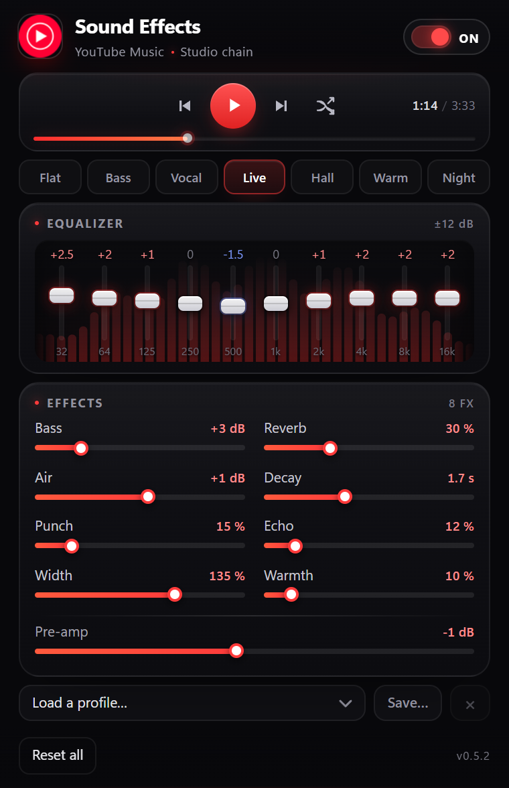

# YTM Sound Effects

Real-time sound effects for YouTube Music — EQ, bass, reverb, echo, and more.  
Works in Brave and other Chromium browsers.

  

## Install

1. Download this repo.
2. Open `brave://extensions` and enable **Developer mode**.
3. Click **Load unpacked** and select this folder.
4. Open [YouTube Music](https://music.youtube.com) and play a track.

## Features

- 10-band EQ, bass, air, punch, warmth, width, reverb, echo
- Presets and saved profiles
- Previous / play-pause / next / shuffle, with click or drag seeking
- Live spectrum, response curve, and ad silence

## License

MIT © 2026 [Magri Mohammed Yassine](https://github.com/yassine808). See
[LICENSE](LICENSE) for the full text.
